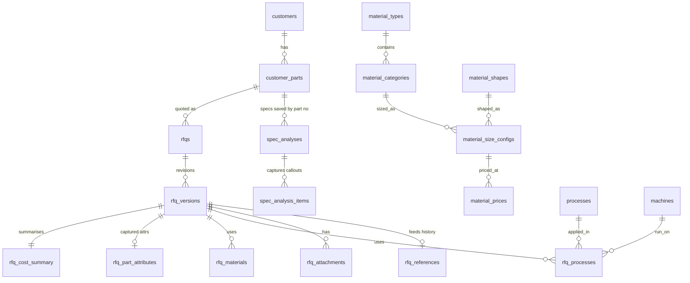

# RFQ & Cost Estimation System

A web application for **forging‑part manufacturers** that turns an incoming RFQ (with a
customer design drawing) into a **defensible, itemised estimated quotation**.

The system reads the drawing, captures part and material attributes, and a **deterministic
cost engine** computes the quote from configured master rates. AI assists with drawing
extraction and historical lookup — **it never sets the price**. Every RFQ carries multiple
**versions per revision**, keyed to the **Customer Part Number**, and completed estimates
become **historical reference data** for future RFQs.

**Status:** MVP feature‑complete (phases 0–7), security hardening (phase 8) and an automated test
suite (phase 10), then data‑integrity and scale work (phase 11): 357 unit tests + 264 API
integration tests + 35 browser (UI) tests + 26 end‑to‑end smoke checks, run in CI.

---

## Table of contents

- [Guiding principles](#guiding-principles)
- [The cost model](#the-cost-model)
- [Functionality](#functionality)
  - [Master data](#1-master-data)
  - [Customer parts & RFQ versioning](#2-customer-parts--rfq-versioning)
  - [Spec Analysis — drawing → data](#3-spec-analysis--drawing--data)
  - [Deterministic cost engine](#4-deterministic-cost-engine)
  - [History & reference lookup](#5-history--reference-lookup)
  - [Quotation & exports](#6-quotation--exports)
  - [Dashboard](#7-dashboard)
  - [Audit log & security](#8-audit-log--security)
- [Roles & permissions](#roles--permissions)
- [Technical architecture](#technical-architecture)
- [Data model](#data-model)
- [API reference](#api-reference)
- [Frontend](#frontend)
- [Local setup](#local-setup)
- [Configuration](#configuration)
- [Scripts](#scripts)
- [Testing](#testing)
- [Deployment](#deployment)
- [Project layout](#project-layout)
- [Known limitations](#known-limitations--follow-ups)

---

## Guiding principles

1. **AI assists, rules decide.** PDF extraction and historical lookup use an LLM; all costing
   is a pure, deterministic, server‑side engine that is independent of the LLM and unit‑tested.
2. **Specs become saved data, keyed to the part number.** Every customer drawing is parsed
   into a structured **Spec Analysis** record and persisted against the **Customer Part
   Number** + RFQ revision — so a part's captured specs, revisions and past quotes are always
   retrievable and reusable.
3. **Everything is master‑driven and effective‑dated.** Prices and rates change over time;
   every estimate records the rate that was valid on its costing date.
4. **Versioned by revision.** A Customer Part Number can be re‑quoted many times; each
   revision is a new **RFQ Version** with its own cost sheet, and all history is preserved.
5. **Auditable.** Each quote line ties back to a rate × quantity/time and a formula; both the
   AI‑recommended and estimator‑set values are stored, and every mutation is logged.

---

## The cost model

The engine is a pure function: `computeCost(EngineInput) → CostSummary`. Each component is
independently testable.

```
Material base cost
  + Handling            (procurement % + transportation + storage %)
  + Machining cost       (machine processes)
  + Manual process cost  (₹/pc processes)
  + Subcontracting cost  (heat treatment, plating, …)
  + QC cost              (auto-derived — the user never types it)
  = Manufacturing cost
  + Administration cost  (% of manufacturing cost)
  = Subtotal
  + Profit margin        (% driven by Customer Rating; estimator may adjust or override)
  = Quoted price / piece   ×  quantity = Total quote
```

### Material base cost / purchase cost (§4.1)

```
# MANUFACTURED
input_weight_kg = net_weight_kg × (1 + forging_loss_pct/100)     ← the forging allowance
material_cost   = input_weight_kg × (1 + wastage_pct/100) × rate_per_kg(as-of date)

# BOUGHT_OUT (procured / assembly part)
material_cost   = purchase_price_per_pc
```

`rate_per_kg` is resolved from **Material Category (grade) × Shape × Size config**,
effective‑dated (`material_prices`). If the estimator enters an explicit **material line**
(e.g. a bar‑stock cut weight), that `input_weight_kg` overrides the `net × (1 + loss)` rule.

A **bought‑out part** (`sourcing_type = BOUGHT_OUT`) skips the material weight/rate and the
machining build‑up — its purchase price is the base. Handling, QC, admin and margin still
apply; process lines are still summed, so you can add assembly / incoming‑inspection lines.

### Handling cost (§4.2)

```
procurement    = base_cost × procurement_pct/100
storage        = base_cost × storage_pct/100
transportation = transportation_value × input_weight_kg   (PER_KG)
               = transportation_value / batch_qty         (PER_LOT, amortised)
               = transportation_value                     (FIXED, ₹/pc)
               = base_cost × transportation_value/100      (PCT)
packing        = packing_value                            (FIXED, ₹/pc)
               = base_cost × packing_value/100             (PCT)
```

`base_cost` is the material / purchase cost. **Transportation and packing both default to 0**
and are each either a fixed ₹/pc or a percentage. From a **Handling Config** master — global,
or per material type (specific wins over global).

### Machine / manual / subcontract process cost (§4.3–4.5)

Every process line carries a **costing method**, and the same per‑piece formula is applied
then bucketed by process type (`MACHINE` → machining, `MANUAL` → manual, `SUBCONTRACT` →
subcontract):

| Method | Formula | Best for |
|---|---|---|
| **`CYCLE_TIME`** *(default)* | `(cycle_time_sec / 3600) × machine_hour_rate` | CNC turning/milling, VMC, drilling |
| **`PER_KG`** | `input_weight_kg × rate_per_kg` | Forging press / hammer operations |
| **`PER_STROKE`** | `strokes × rate_per_stroke` | Press forging |
| **`PER_OP`** | `count × standard_op_rate` | Well‑known repeatable ops |
| **`FLAT_PC`** | `count × rate_per_pc` | Simple, stable operations |
| **`PER_LOT`** | `rate_per_lot / batch_qty` | Lot‑priced subcontracting |

**Machine‑hour rate build‑up** (stored per machine so it is transparent):

```
machine_hour_rate = depreciation/hr + power/hr + maintenance/hr
                    + operator/hr + tooling/hr + factory_overhead/hr
```

If a `CYCLE_TIME` line's rate is left blank, the engine falls back to the machine's
hour‑rate; other methods fall back to the process's `default_rate`.

### QC cost — auto‑derived (§4.6)

QC is **never typed by the user**; a configurable QC rule derives it:

| Method | Formula |
|---|---|
| **`PCT_OF_MFG`** *(default)* | `(material + handling + machining + manual + subcontract) × qc_pct/100` |
| **`PER_INSPECTION`** | `Σ` of the named inspection costs (FAI, in‑process, final, CMM, certificate) |
| **`RULE`** | `pre_qc_cost × (qc_pct + uplift_pct)/100` |

### Administration + margin (§4.7)

```
mfg_cost      = material + handling + machining + manual + subcontract + qc
admin_cost    = mfg_cost × admin_pct/100
subtotal      = mfg_cost + admin_cost
recommended   = base_margin(customer.rating) + estimator_adjustment_pct
margin_pct    = estimator_override_pct ?? recommended          (0 is respected)
quoted_per_pc = subtotal × (1 + margin_pct/100)
total_quote   = quoted_per_pc × quantity
```

Both `recommended` (`ai_recommended_margin_pct`) and the final `margin_pct` are stored on
the cost summary and written to the audit log.

---

## Functionality

### 1. Master data

All master data is config‑driven (one generic CRUD component) with search, soft‑delete and
RBAC. The navigation pane has **one entry per functional area**; each opens a **tabbed
screen**, and parent rows drill into their child records:

| Nav entry | Sections (tabs) | Drill‑down |
|---|---|---|
| **Customer Master** | Customers · Rating → Margin | — |
| **Material Master** | Types · Grades · Shapes · Handling | **Grades** and **Shapes** rows → **Size configs** (scoped) → **Prices** (scoped) |
| **Process & Machine** | Processes · Machines | — |
| **Costing Configuration** | Product Types · QC · Overhead / Admin | — |

Size configs and prices are **not** top‑level tabs — they are reached only via a parent row's
"Size configs" / "Prices" action, which opens the child list filtered to that parent (the
parent field is pre‑filled and locked in the create form). A "Back" breadcrumb returns up the
chain. Server‑side this uses `?<fkField>=<id>` filtering (`filterableFields` on the CRUD
factory).

| Master | Notes |
|---|---|
| **Customers** | Rating 1–5 — drives the margin recommendation |
| **Customer rating → margin map** | Base margin % per rating 1–5 |
| **Material types → grades → shapes → size configs → prices** | The hierarchy; grade carries density, price is effective‑dated ₹/kg |
| **Handling config** | Procurement % · storage % · **transportation** (PER_KG / PER_LOT / FIXED ₹/pc / PCT) · **packing** (FIXED ₹/pc / PCT) — transport & packing default to 0; global or per material type |
| **Processes** | `process_type` (MACHINE/MANUAL/SUBCONTRACT) + `costing_method` + default rate |
| **Machines** | Hourly‑rate build‑up (the `hourly_rate` is a derived roll‑up) |
| **Product types** | Used in part analysis + history reference |
| **QC config** | Method + `qc_pct` + inspection standards (JSON) |
| **Overhead config** | Administration % |

**Effective‑date integrity:** `effectiveTo ≥ effectiveFrom` is enforced, and creating a new
rate row **auto‑closes the prior still‑open row** (stamps its `effectiveTo` with the new
`effectiveFrom`) so lookups are always unambiguous.

### 2. Customer parts & RFQ versioning

- **Customer Parts** — the anchor for RFQs and saved spec data (customer, part number, part
  name, product type, drawing no, current revision).
- **RFQ** — header (RFQ number, part, dates, annual/batch qty, currency, status). Creating an
  RFQ also creates **revision 1**. The **RFQ number is auto-generated** as `YYYY/MM/NNNN` —
  `NNNN` is a running counter that resets to `0001` when the year rolls over (the month segment
  is display-only). A number can still be supplied explicitly.
- **New RFQ from spec** — a wizard (`/rfqs/new`): upload the customer drawing → the part number
  (usually in the file name), customer, revision and specs are read from it → a **revision
  prompt** appears if that part already has an RFQ → enter annual/batch qty → the RFQ (or a new
  revision on the latest RFQ for that part) is created with a **draft cost sheet** already
  built, and the quotation can be generated in one click. An unknown customer is auto-created
  (rating 3) and a missing material grade is flagged for the estimator.
- **RFQ Versions** — `POST /rfqs/:id/versions` adds a new revision: auto `revision_no = max+1`,
  flips `is_current` on the siblings in one transaction, and can copy part attributes from an
  existing version. Every version has its own `rfq_part_attributes`, cost sheet and reference.
- **RFQ detail screen** — editable RFQ header, a **revision switcher**, per‑revision
  **part‑attributes** form (**sourcing: manufactured / bought‑out**, then either material
  grade/shape + forging loss % **or** purchase price + supplier, plus product type, net weight,
  surface finish, hardness, heat treatment, dimensions/tolerances/features, reviewed flag),
  and "Make current".
- **RFQ grid** — filter by status + free text, status pills, current‑revision quoted price,
  link to detail.

### 3. Spec Analysis — drawing → data

The core capability: **read the customer PDF, generate structured data, save it by part
number.**

1. **Upload** a PDF or image drawing (`POST /rfq-versions/:id/attachments`, Multer → disk).
2. **Analyze** (`POST /rfq-versions/:id/analyze-spec`) — the drawing is sent to Claude
   (`claude-opus-5`, document/vision block) with a strict extraction prompt. The model returns
   `{ header, items[], flags[] }`:
   - **header** — title‑block identity (drawing no, title, customer, CO no, rev, sheet, scale,
     material note, designed/detailed/checked, date) and overall attributes (product type,
     overall length, max OD, across‑flats, section view, general‑tolerance table, notes).
   - **items** — every callout as a generic row: `DIAMETER`, `LENGTH`, `THREAD`, `HOLE`,
     `CHAMFER`, `UNDERCUT`, `GROOVE`, `GDT`, `SURFACE_FINISH`, `TOLERANCE`, `ACROSS_FLATS`,
     `NOTE` — with nominal value, unit, tolerances, fit class (e.g. `m6`), datum, GD&T type,
     verbatim `raw_text` and a per‑item confidence.
   - **flags** — missing / ambiguous data the estimator must resolve (e.g. material shown as
     "AS PER BOM").
3. **Persist** — one `spec_analysis` row **upserted per `(customer_part_id, revision)`**, plus
   its `spec_analysis_items`. Re‑analyzing the same part revision updates it (and resets
   `reviewed`); a new revision adds a new row. The full raw extraction is kept in
   `raw_extract` (JSON).
4. **Derive weights** — `est_input_weight_kg` = bounding bar stock (max OD × overall length);
   `est_net_weight_kg` = mean captured diameter over the length. Both feed the cost engine.
5. **Review** — an editable grid grouped by item type, editable header fields, add/remove
   items, "Save & mark reviewed" (`PUT /rfq-versions/:id/spec`).
6. **Apply** — `POST /rfq-versions/:id/spec/apply` pushes `est_net_weight_kg` →
   `part_attributes.net_weight_kg`, matches the product type, and records the material note.

**Drawing files are kept per revision.** Every uploaded file is an `rfq_attachment` on that
version and can be **downloaded** from the RFQ (`GET …/attachments/:aid/download`) or the
Quotation panel. **Re-analyze** reuses the drawing already on file — the version's own, else
the last one saved for that part number (copied onto the new revision); only when nothing is
on file does it ask for an upload (`409 { needsUpload: true }`).

**No API key, or no credit? Free text reading.** Without a usable key the analyzer reads the **PDF's own
text** (no AI, no cost): drawing no., item name (the `TITLE:` cell), material grade (the `MATERIAL:` cell or
BOM column), revision, units (`ALL DIMENSIONS ARE IN mm` or inch marks) and the printed "Ø × length" size
(`SHAFT 26 X 84 LONG`, `2 1/2" DIA X 49 1/8" LG.` → 63.5 × 1247.8 mm). Results are labelled **read from PDF
text** (`source: 'text'`) with a flag saying what was *not* read — dimensions, tolerances and notes need the AI
reading. Where a field has no label it is **guessed by position and flagged to confirm**. A scanned PDF (no
selectable text) or an image cannot be read this way and is refused with a message saying so. Set
`SPEC_EXTRACTOR=text` to read text only even while a key is set (e.g. an unfunded account); the default `auto`
uses the AI whenever a key is configured. Only if neither works does it **refuse (503) with a clear message** —
it never makes up values. (It used to return one canned shaft for every drawing, which made every
upload look identical.) Demos and the automated tests opt in to that canned sample with
`SPEC_ALLOW_MOCK=true`; it is then labelled **SAMPLE DATA** everywhere it appears. A failed model call
is explained, not hidden: *no credit left*, *key rejected*, *rate limited*, *file too large*.

**What is read from the title block.** `header.itemName` (the part's printed name, e.g. "BRUSH HOLDER")
becomes the part name; `header.materialGrade` (e.g. "304L SS") picks the grade. The grade is matched to
the Material Master ignoring case, spaces and family words (`304L SS` = `SS304L` = `304L`); when nothing
matches, the wizard says so and asks you to pick one. Drawings in **inches** are converted to mm by the
extraction (`units: "inch"`, × 25.4).

**Test Drawings folder** (`/test-drawings`, ADMIN / MANAGER / ESTIMATOR): an internal page for trying
drawings. Upload many PDFs or images at once, run the extraction on each (one by one, or *Analyze new*),
and compare what was read — drawing no., item name, grade (and the master grade it maps to), units,
Ø and length in mm, item and flag counts — in one sortable table. Click a file to see everything read,
the model, seconds and token usage. A banner states whether a click uses the **live** model (paid),
the free **text** reader or the **sample** stub (each row also has a free *Read text* button when the AI is on); if different files come back with identical values the page
warns you. Nothing there creates a customer, part or RFQ. Files live in `uploads/test-drawings/` (results
in `_analysis/`) — back that folder up like the rest of `uploads/` if you care about it.
`GET /customer-parts/:id/specs` returns the full versioned spec history for a part.

### 4. Deterministic cost engine

- **Pure function** in `apps/api/src/cost-engine/` — no Prisma, no Express, no LLM, no clock
  beyond a caller‑supplied `asOfDate`. Fully covered by **29 vitest unit tests**.
- **Resolver** (`resolve.ts`) loads a version + effective‑dated masters (material price as‑of
  date, handling config with specific→global fallback, QC / overhead / margin lookup) into an
  `EngineInput`, collecting **warnings** for anything missing.
- **Cost sheet editor** on the RFQ detail page: a material line, a process‑line grid
  (process / machine / method / qty / rate, blank rate = auto), margin adjustment/override
  inputs, a **Compute** button, resolver warnings, and the full cost build‑up table.
- `POST /rfq-versions/:id/compute` runs the engine, upserts `rfq_cost_summary`, writes each
  line's computed `cost` back, and moves `DRAFT → COSTED`. `persist: false` computes without
  saving (live preview).
- **Calculation trace** — the engine also returns `explain[]`: for every row of the build‑up
  (material, handling, each process bucket, QC, admin, subtotal, margin, quoted, total) a
  formula in words plus the substituted numbers and the sub‑total. It is stored on
  `rfq_cost_summaries.explain_json`, and each row of the cost‑sheet table has an **info**
  button that expands the breakdown inline (works on page load, no recompute needed).

### 5. History & reference lookup

- When a version reaches **QUOTED / WON / LOST**, an `rfq_reference` row is (re)built:
  product type, material grade, key dims (pulled from the part's spec analysis), quoted ₹/pc,
  outcome, and an optional **actual cost**.
- `GET /reference/similar?partId=… | versionId=…` ranks past references by a weighted
  similarity score: `+3` same product type, `+3` same material, decaying proximity on
  net weight (×2.5), OD (×1.5), length (×1.5), across‑flats (×0.5), plus a small bonus for
  proven (WON) quotes. The part itself is excluded.
- "Reference & similar RFQs" panel on the RFQ detail page — match‑strength bars, quoted vs
  actual price, outcome pills, and controls to set the actual cost / mark won / mark lost.

### 6. Quotation & exports

- `POST /rfq-versions/:id/quote` — approve + generate: marks the revision (and RFQ) `QUOTED`,
  records the reference, and returns the quotation view model.
- Downloads (blob fetch with the auth header, so they work behind JWT):
  - `GET /rfq-versions/:id/cost-sheet.pdf` — full itemised cost sheet (pdfkit)
  - `GET /rfq-versions/:id/cost-sheet.xlsx` — the same as a formatted spreadsheet (exceljs)
  - `GET /rfq-versions/:id/quotation.pdf` — client‑facing quote: company letterhead + logo,
    Bill‑to / Part blocks, line‑item table, right‑aligned totals, and — **anchored to the
    bottom of the page** — left‑aligned bulleted **Terms & conditions** and **Notes** with a
    right‑aligned **Authorised Signatory** block; 30‑day validity
- "Quotation & export" panel on the RFQ detail page with one‑click downloads.

### 7. Dashboard

`GET /reports/dashboard` → live KPIs (RFQs, customer parts, open quotes, win rate),
open‑pipeline value, won value, active customers, a 6‑month **RFQs / quoted / won** bar chart,
and a clickable **recent‑activity** feed.

The monthly chart buckets by **when it happened**: `rfq_versions.quoted_at` / `decided_at` are
stamped when a version enters QUOTED / WON / LOST (one helper, `lib/versionStatus.ts`, used by
every path that changes status — editing the version, approving the quotation, and **Mark won /
lost**), not by `updated_at`, which moves on any edit. Marking a quotation won or lost is a real
status change, so it counts toward win rate and won value.

### 8. Audit log & security

- **`audit_log`** — every master, customer‑part, RFQ, version, **compute** (final vs
  AI‑recommended margin), **quote**, and spec analyze/review mutation is recorded with the
  actor. Fire‑and‑forget: a logging failure never breaks the request it records.
- **Audit Log screen** (`GET /audit-log`, ADMIN/MANAGER only) — filter by entity type,
  per‑action badges, actor name, JSON change payload.
- **Hardening** — `helmet`; global rate limit (300 req/min) + stricter auth limit
  (20 attempts / 15 min); production CORS allow‑list (`WEB_ORIGIN`); 35 MB body cap;
  `x-powered-by` off; parameterised queries throughout via Prisma.
- **Auth** — JWT (24 h); `GET /auth/me` and `POST /auth/refresh`; the SPA re‑hydrates roles
  from the server on load. **There is no public sign‑up** — accounts are created by an
  administrator on the Security screen.
- **Access follows the database, not the token.** `authenticateToken` verifies the JWT and then loads
  the user's current `is_active` flag and roles on **every request** (one primary‑key lookup). Roles on
  `req.user` come from the database, so deactivating, deleting or demoting someone takes effect on
  their very next request — a still‑valid token no longer carries stale access. A deactivated user
  gets 401 (the SPA signs them out).
- **JWT secret enforcement** — `lib/env.ts` loads `.env` *before* any other module and validates
  `JWT_SECRET`. In production the API **refuses to start** if the secret is missing, a known
  placeholder, or shorter than 32 characters; in development it warns and uses an insecure
  dev‑only fallback.

### 9. Company / firm profile

A single **Company Details** screen (ADMIN/MANAGER) — name, address, phone, email, website,
GSTIN, **logo** (PNG/JPEG, ≤ 1 MB, stored as a data URI) and a quotation footer note. Exactly
one row is ever kept (`company_settings`; `singleton` is a unique column and the seed creates
a ready‑to‑use sample record — *Sparkline Equipments (P) Ltd*), so the screen always
opens on that one record and `PUT /company` just updates it. The details render on the **quotation and cost-sheet PDF
headers** (with the logo) and the company name shows in the app's top bar.

### 10. Security — users & roles

One **Security** screen (`/security`, ADMIN only) with a **Users / Roles** switch:

- **Users** — CRUD over `Name · Contact number · Email · Password · Role`. One role per user;
  passwords are bcrypt‑hashed (edit leaves the field blank to keep the current one). "Delete"
  is a soft de‑activate that keeps history; you cannot deactivate your own account or the last
  remaining active administrator.
- **Roles** — the catalogue. The four built‑in roles (Admin, Manager, Estimator, View only)
  have code‑wired permissions and can be **renamed / re‑described** but not re‑permissioned.
  You can add extra roles; they behave as **view‑only** until a developer wires their `code`
  into the middleware. **Roles cannot be deleted** (only edited).

### 11. Shell & UX

- **Dark / light theme** — toggled from the top-bar or the user menu; the choice is stored per
  browser and falls back to the OS preference (applied before first paint, no flash).
- **Top bar** — company name, a theme toggle, and a **user menu** on the right (name, email, roles, logout).
- **Collapsible navigation** — the sidebar hides / shows from the top-bar toggle; the state is
  remembered.
- **Full-width content** — the working area (grids, cost sheets) uses the full page width.
- **Data grids** — every browsing grid (masters, customer parts, RFQ list, audit log, similar
  RFQs) has **click-to-sort columns** (asc → desc → off) and **pagination** (10/25/50/100 rows)
  via a shared `DataGrid` component.

---

## Roles & permissions

| Role | Can do |
|---|---|
| **ADMIN** | Everything, including **Users** and **Roles** administration |
| **MANAGER** | Everything except user / role administration — includes master data, company details + audit log |
| **ESTIMATOR** | Customer parts, RFQs, spec analysis, cost sheets, quotations, cost‑sheet export |
| **VIEWER** *(View only)* | View RFQs and **download the quotation PDF** — nothing else (no create / update / re‑generate, no masters, company, users or roles; the internal cost‑sheet export is also blocked) |

Enforced by `requireRole` / `canEditMasters` (ADMIN, MANAGER) / `canEditRfq`
(ADMIN, MANAGER, ESTIMATOR) / `canManageUsers` (ADMIN). ADMIN always passes. The SPA mirrors
this: the **Masters** nav + routes need `canEditMasters`, **Customer Parts** and **New RFQ**
need `canEditRfq`, so a View‑only user sees just Dashboard, RFQs and the quotation download.

The **Security** screen (`/security`, ADMIN only) has a Users / Roles switch. **Users** — full CRUD
over `Name · Contact number · Email · Password · Role` (one role per user); delete is a soft
de‑activate; the last active administrator cannot be demoted or deactivated. **Roles** — the
four built‑in roles above can be **renamed and re‑described** but not re‑permissioned; you may
add extra roles, which are treated as **view‑only** until wired into the code. Roles are never
deleted.

Default seeded admin: **`admin@rfq.local` / `Admin@123`** — change the password after first
login. There is no self‑registration endpoint; further users are added by an ADMIN on the
Security screen (`POST /users`).

---

## Technical architecture

### Stack

| Layer | Technology |
|---|---|
| **Frontend** | React 18 · Vite · TypeScript · Tailwind CSS · shadcn‑style UI (Radix primitives) · TanStack Query · React Router · React Hook Form + Zod · Recharts · lucide‑react · Sonner |
| **Backend** | Node.js · Express · TypeScript (run via `tsx`) · Prisma ORM · Zod · JWT · bcrypt · Multer · helmet · express‑rate‑limit |
| **AI** | `@anthropic-ai/sdk` — Claude `claude-opus-5` (document / vision extraction only) |
| **Reports** | pdfkit (PDF) · exceljs (XLSX) |
| **Database** | Microsoft SQL Server (Prisma `sqlserver` provider) |
| **Cost engine** | Framework‑free pure TypeScript, unit‑tested with Vitest |

### Monorepo (npm workspaces)

```
apps/
  api/                Express + Prisma + cost-engine + spec-analysis + reports
  web/                React + Vite SPA
packages/
  shared/             Zod schemas, enums and shared types used by both apps
prisma/               schema.prisma, migrations, seed
scripts/              smoke.mjs — end-to-end check
```

`@rfq/shared` is consumed **from source** (its `main` is `src/index.ts`) — Vite aliases it and
the API runs TypeScript directly with `tsx`, so there is no separate build step for it.

### Request flow

```
Browser ──▶ Vite dev proxy (/api → :4000)  ──▶ Express
                                               ├─ helmet, rate-limit, CORS, JSON(35mb)
                                               ├─ authenticateToken (JWT)  → requireRole
                                               ├─ validateBody(zodSchema)  (422 on failure)
                                               ├─ route handler ── Prisma ── SQL Server
                                               │                └─ audit(req, …)  (async, non-blocking)
                                               └─ errorHandler (Zod / Prisma P2002·P2025·P2003 / status)
```

In production (`NODE_ENV=production`) the API also serves the built SPA from the same process
and port (SPA fallback for non‑API GET routes).

### Notable implementation details

- **BigInt & Decimal serialization** — `BigInt.prototype.toJSON` is patched globally so Prisma
  ids serialize as strings (matching the shared Zod schemas, which treat ids as numeric
  strings).
- **Generic CRUD factory** (`lib/crud.ts`) — one `crudRouter(delegate, options)` powers every
  master: search, `?<fk>=<id>` filtering (drill‑down scoping), soft‑delete,
  FK‑string→BigInt coercion, derived‑field transforms, effective‑date auto‑close, and audit
  logging.
- **`RfqPartAttributes` references are real foreign keys** to material category / shape / product
  type (`onDelete: NoAction` — masters are soft‑deleted, and SQL Server forbids multiple cascade
  paths). Reads use the relations (`include`); writes validate the ids first and answer a clear 422
  ("Unknown material grade…") instead of a bare constraint error.
- **Optional server‑side paging** on the lists that grow — `/rfqs`, `/customer-parts`, `/customers`,
  every generic master, and `/audit-log`. See [Paging](#paging).
- **SQL Server long text** — all JSON / long‑text columns are `@db.NVarChar(Max)` (the Prisma
  default is `NVARCHAR(1000)`).
- **Spec‑analysis relations** use `onDelete: NoAction, onUpdate: NoAction` to satisfy SQL
  Server's single‑cascade‑path rule.

---

## Data model

29 tables (Prisma models). PK = `id` (`BIGINT` identity); masters carry `is_active` +
timestamps; effective‑dated masters carry `effective_from` / `effective_to`.

### Platform & auth
`users` · `roles` · `user_roles` · `audit_logs` · `company_settings` (singleton — seller
name / address / contact / GSTIN / logo, used on the PDFs)

### Masters
`product_types` · `material_types` · `material_categories` · `material_shapes` ·
`material_size_configs` · `material_prices` · `handling_configs` · `processes` · `machines` ·
`qc_configs` · `overhead_configs` · `customer_margin_maps` · `customers`

### Customer parts & RFQ (versioned)
- `customer_parts` — customer + `customer_part_number` + product type + drawing no + current revision
- `rfqs` — RFQ number, part, dates, annual/batch qty, currency, status, created by
- `rfq_versions` — `revision_no`, label, `based_on_part_revision`, status, `is_current`
- `rfq_part_attributes` — per version: `sourcing_type` (MANUFACTURED / BOUGHT_OUT),
  purchase price + supplier (bought‑out), material category/shape, net weight, forging loss %,
  dimensions/tolerances/features (JSON), surface finish, hardness, heat treatment, `reviewed`
- `rfq_materials` — the material line (size config, input weight, rate/kg, wastage %, cost)
- `rfq_processes` — process lines (process, machine, method, qty/time, rate, cost, sequence)
- `rfq_cost_summary` — the full build‑up + `margin_pct` + `ai_recommended_margin_pct` + total
- `rfq_attachments` — uploaded drawings
- `rfq_references` — the growing history: product type, material, key dims (JSON), quoted
  ₹/pc, outcome (`QUOTED`/`WON`/`LOST`), actual cost

### Spec Analysis
- `spec_analyses` — one per `(customer_part_id, revision)`: title‑block identity, overall
  attributes, `est_net_weight_kg` / `est_input_weight_kg`, `raw_extract` (JSON),
  `overall_confidence`, `reviewed`, optional links to the triggering `rfq_version` and
  `rfq_attachment`
- `spec_analysis_items` — generic callout rows (`item_type`, label, nominal, unit, tolerances,
  `tol_class`, datum, `gdt_type`, `raw_text`, confidence, `reviewed`)

### ER sketch



---

## API reference

All endpoints require `Authorization: Bearer <jwt>` **except** `POST /auth/login` and
`GET /health`. Validation failures return `422` with a `{ error, issues[] }` body.

### Auth
| Method | Path | Notes |
|---|---|---|
| POST | `/auth/login` | `{ email, password }` → `{ token, user }` (rate‑limited) |
| GET | `/auth/me` | Current user + roles (source of truth) |
| POST | `/auth/refresh` | Swap a valid token for a fresh one |

### Masters (`GET`/`POST`/`PUT`/`DELETE`; edit = ADMIN/MANAGER)
`/customers` · `/product-types` · `/material/types` · `/material/categories` ·
`/material/shapes` · `/material/size-configs` · `/material/prices` · `/handling-config` ·
`/processes` · `/machines` · `/qc-config` · `/overhead-config` · `/customer-margin-map`

List endpoints accept `?search=` (where applicable), `?activeOnly=false`, and — for the
material hierarchy — FK filters for drill‑down (`/material/categories?materialTypeId=`,
`/material/size-configs?materialCategoryId=&materialShapeId=`,
`/material/prices?materialSizeConfigId=`, `/handling-config?materialTypeId=`).

### Customer parts
| Method | Path | Notes |
|---|---|---|
| GET | `/customer-parts` | `?search=` `?customerId=` |
| GET | `/customer-parts/:id` | Includes customer, product type, RFQs, spec analyses |
| GET | `/customer-parts/:id/specs` | Full versioned spec history |
| POST / PUT | `/customer-parts` · `/customer-parts/:id` | edit = ADMIN/MANAGER/ESTIMATOR |

### Paging

List endpoints are **backward compatible**: with no paging parameters they return the whole list as a
plain array, exactly as before. Add `?page=` / `?pageSize=` to get one page:

| Parameter | Meaning |
|---|---|
| `page` | 1‑based page number (≥ 1) |
| `pageSize` | rows per page, 1–200 (larger values are capped at 200) |
| `sort`, `dir` | sort key and `asc`/`desc`. `/rfqs` and `/customer-parts` accept a fixed set of keys (`rfqNumber`, `customer`, `part`, `status`, `rfqDate`… / `customerPartNumber`, `partName`…); masters accept any real column. An unsupported key is a 4xx, never a 500 |

The body stays a plain array (the requested page); the **full filtered count** is in the
`X-Total-Count` response header (exposed to browsers via CORS). The order is made stable with an `id`
tie‑breaker, so pages never overlap or skip rows. Invalid values (`page=0`, `pageSize=abc`…) are 422.
`/audit-log` pages newest‑first; without paging it keeps its original `?limit=` (default 100, max 500).
The web app pages RFQs, Customer Parts, Customer Master and the Audit Log on the server; the small
masters (materials, processes, machines…) still load fully and sort in the browser.

### RFQ
| Method | Path | Notes |
|---|---|---|
| GET | `/rfqs` | `?search=` `?status=` `?customerId=` · pageable (see Paging) |
| GET | `/rfqs/:id` | Full RFQ + all versions |
| GET | `/rfqs/:id/versions` | Version list |
| POST | `/rfqs` | Creates RFQ + revision 1 (`rfqNumber` optional — auto `YYYY/MM/NNNN`) |
| PUT | `/rfqs/:id` | Header (dates, qty, currency, status) |
| POST | `/rfqs/:id/versions` | New revision (`copyFromVersionId?`) |
| POST | `/rfqs/spec-preview` | multipart `file` — analyze a drawing, resolve lookups, **create nothing** |
| POST | `/rfqs/from-spec` | multipart `file` + `payload` — create the RFQ/revision, spec, draft cost sheet (`409 needsRevisionConfirm` until `confirmRevision:true`) |

### RFQ version
| Method | Path | Notes |
|---|---|---|
| GET | `/rfq-versions/:id` | Version + attributes + materials + processes + cost summary + reference + attachments |
| PUT | `/rfq-versions/:id` | `versionLabel`, `basedOnPartRevision`, `status`, `makeCurrent`, `partAttributes` |
| PUT | `/rfq-versions/:id/processes` | Replace all process lines |
| PUT | `/rfq-versions/:id/materials` | Set / clear the single material line |
| POST | `/rfq-versions/:id/compute` | Run the cost engine (`quantity?`, `marginAdjustmentPct?`, `marginOverridePct?`, `asOfDate?`, `persist?`) |
| POST | `/rfq-versions/:id/quote` | Approve + generate quotation |
| POST | `/rfq-versions/:id/reference` | Set outcome / actual cost |

### Spec analysis
| Method | Path | Notes |
|---|---|---|
| POST | `/rfq-versions/:id/attachments` | Multipart `file` — PDF or image |
| GET | `/rfq-versions/:id/attachments` | List uploaded drawings |
| GET | `/rfq-versions/:id/attachments/:aid/download` | Download the file (410 if missing on disk) |
| DELETE | `/rfq-versions/:id/attachments/:aid` | Remove a drawing (canEditRfq) |
| POST | `/rfq-versions/:id/analyze-spec` | AI extraction → persist by part number; reuses a saved drawing, else `409 { needsUpload }` |
| GET | `/rfq-versions/:id/spec` | The saved spec (404 if none) |
| PUT | `/rfq-versions/:id/spec` | Estimator review / correct |
| POST | `/rfq-versions/:id/spec/apply` | Push derived data onto part attributes |

### History
| Method | Path | Notes |
|---|---|---|
| GET / POST / DELETE | `/test-drawings`, `/test-drawings/:name/{file,analyze,analysis}` | internal test folder: list (+ `extraction: live\|text\|sample`; `POST …/analyze?mode=text` reads the PDF text only), multi-file upload (`files`), view, analyze one, stored result, delete — ADMIN / MANAGER / ESTIMATOR |
| GET | `/reference/similar` | `?partId=` or `?versionId=` (`&limit=`) → `{ target, matches[] }` |

### Reports & documents
| Method | Path | Notes |
|---|---|---|
| GET | `/reports/dashboard` | Aggregates for the dashboard |
| GET | `/rfq-versions/:id/cost-sheet.pdf` | Cost sheet (PDF) |
| GET | `/rfq-versions/:id/cost-sheet.xlsx` | Cost sheet (Excel) |
| GET | `/rfq-versions/:id/quotation.pdf` | Quotation (PDF) |

### Audit & settings
| Method | Path | Notes |
|---|---|---|
| GET | `/audit-log` | ADMIN/MANAGER — `?entityType=` `?entityId=` `?action=` `?limit=` |
| GET / PUT | `/company` | The singleton company / firm profile (PUT = ADMIN/MANAGER, upsert) |
| GET / POST / PUT / DELETE | `/users` | ADMIN only — user CRUD (`name`, `email`, `phone`, `password`, `roleId`, `isActive`); DELETE de‑activates; last‑admin protected |
| GET | `/roles` | Any authenticated user — the role catalogue (used by the user form) |
| POST / PUT | `/roles` | ADMIN only — add a custom role, rename / re‑describe any role. Roles are never deleted (`DELETE` → 405) |

### Misc
| Method | Path | Notes |
|---|---|---|
| GET | `/health` | Liveness |

---

## Frontend

```
src/
  components/
    ui/               button, card, input, label, badge, table, dialog, field (select/textarea)
    AppShell.tsx      top bar (user menu, theme toggle) + collapsible sidebar + full-width content
    DataGrid.tsx      shared sortable / paginated grid
    PrivateRoute.tsx  auth guard (optional capability: masters | rfq | admin)
  features/
    masters/          config-driven CRUD — configs.ts (4 groups / sections + drill-downs),
                      MasterGroupPage.tsx (tab shell), MasterPage.tsx (list + form), types.ts
    rfqs/             RfqListPage, RfqDetailPage, CreateRfqWizard, CreateRfqDialog, StatusBadge,
                      SpecAnalysis, CostSheet, SimilarRfqs, QuotationPanel, customerPartConfig
  pages/              Login, Dashboard, AuditLog, CompanySettings, Security (hosts Users + Roles)
  lib/                api.ts (axios + resource() + downloadFile), auth.tsx (context), utils.ts
  main.tsx            applies the saved/system theme before render
  App.tsx             routes + providers (QueryClient, AuthProvider, Toaster)
```

### Screens

| Route | Screen |
|---|---|
| `/login` | Login |
| `/` | Dashboard — KPIs, 6‑month chart, recent activity |
| `/rfqs` | RFQ grid — status + search filters, "New RFQ from spec" + manual create |
| `/rfqs/new` | Create-RFQ wizard — upload spec → review → quantities → done |
| `/rfqs/:id` | RFQ detail — header, revision switcher, part attributes, **Spec Analysis**, **Cost Sheet**, **Reference & similar RFQs**, **Quotation & export** |
| `/customer-parts` | Customer Parts (config‑driven CRUD) |
| `/masters/:group[/:tab]` | A master group (Customer / Material / Process & Machine / Costing) with tabbed sections + drill‑downs |
| `/company` | Company / firm details (ADMIN/MANAGER) |
| `/audit-log` | Audit Log (ADMIN/MANAGER) |
| `/security` | **Security** — Users / Roles switch on one page, `?tab=roles` (ADMIN) |

The RFQ detail page is the workbench: pick a revision, extract & review the drawing, apply the
derived weights, build the cost sheet, compute, check comparable history, then generate the
quotation and download the PDF/Excel.

---

## Local setup

### Prerequisites
- **Node.js 18+** with npm
- **Microsoft SQL Server** reachable over TCP with a login for the app

> On the machine this was built on, SQL Server runs as the **`SQLEXPRESS`** instance on
> **TCP port 11433** (not 1433). Adjust `DATABASE_URL` to your instance.

### Steps

```bash
# 1. install everything (root + all workspaces)
npm install

# 2. configure
cp apps/api/.env.example apps/api/.env       # then edit DATABASE_URL / JWT_SECRET / ANTHROPIC_API_KEY

# 3. create the database (or let Prisma create it), then:
npm run prisma:generate
npm run prisma:migrate:dev --workspace=@rfq/api   # apply migrations (creates RFQ_DB if missing)
npm run prisma:seed --workspace=@rfq/api          # roles + admin + sample masters + worked examples

# 4. run both dev servers
npm run dev            # API on :4000, web on :5173 (Vite proxies /api → :4000)
```

Open <http://localhost:5173> and sign in with **`admin@rfq.local` / `Admin@123`**.

The seed creates the two worked drawings from the plan — **P01273549** (SHAFT OD 22 × 45) and
**P01273550** (SHAFT 26 × 84) — with spec items and derived weights, plus **RFQ‑2026‑0001**.

---

## Configuration

### `apps/api/.env`

| Variable | Purpose |
|---|---|
| `DATABASE_URL` | Prisma SQL Server connection string |
| `JWT_SECRET` | Token signing secret — **set a long random value** |
| `ANTHROPIC_API_KEY` | `sk-ant-…` for live Spec Analysis (the account needs credit); a placeholder → analysis is refused with a clear message |
| `SPEC_EXTRACTOR` | `text` = read only the PDF's own text (free, no AI call) even when a key is set; default `auto` |
| `SPEC_ALLOW_MOCK` | `true` = with no real key, return a canned sample shaft (demos / tests only; flagged SAMPLE DATA) |
| `SPEC_MODEL` | Override the extraction model (default `claude-opus-5`) |
| `PORT` | API port (default `4000`) |
| `NODE_ENV` | `development` \| `production` |
| `WEB_ORIGIN` | *(prod)* comma‑separated CORS allow‑list |
| `WEB_DIST` | *(prod)* absolute path to `apps/web/dist` if not adjacent |

### `apps/web/.env`

| Variable | Purpose |
|---|---|
| `VITE_API_URL` | Dev only — informational; the Vite proxy target is in `vite.config.ts` |

---

## Scripts

### Root
| Script | Does |
|---|---|
| `npm run dev` | Run API + web dev servers |
| `npm run typecheck` | Typecheck the API + build the web app |
| `npm run build` | Build the web SPA (`apps/web/dist`) |
| `npm test` | Unit tests (no database) |
| `npm run test:integration` | API integration tests against the `RFQ_TEST` database (see [Testing](#testing)) |
| `npm run smoke` | End‑to‑end smoke test against a running API (`SMOKE_URL=` to target another host) |
| `npm run prisma:generate` / `prisma:migrate` / `prisma:seed` | Prisma tasks |
| `npm run db:reset` | Reset the DB + re‑migrate + re‑seed |
| `npm start` | Production single‑process (`NODE_ENV=production`, API serves the SPA) |

### `apps/api`
| Script | Does |
|---|---|
| `npm run dev` | `tsx watch` |
| `npm run start` | `tsx src/index.ts` (production run) |
| `npm run build` | `tsc --noEmit` — typecheck gate, **does not emit `dist/`** |
| `npm test` | `vitest run` — unit tests only |
| `npm run test:integration` | `vitest run -c vitest.integration.config.ts` — API integration tests |
| `npm run test:e2e` | Playwright browser tests (real Chrome, `RFQ_TEST`) — see [Testing](#testing) |
| `npm run prisma:migrate` | `prisma migrate deploy` (production) |
| `npm run prisma:migrate:dev` | `prisma migrate dev` |

---

## Testing

Four layers, from fastest to broadest:

| Layer | Command | Needs a DB? | What it covers |
|---|---|---|---|
| **Unit** | `npm test` | no | cost engine, similarity ranking, weight derivation, suggested process lines, paging, status transitions, auth middleware, error handler, attribute mapping, JWT‑secret rules, the test‑DB guard |
| **API integration** | `npm run test:integration` | yes — `RFQ_TEST` only | the real Express app + SQL Server through supertest: auth, the role matrix, user/role rules, RFQ versioning, the drawing‑to‑RFQ wizard, cost resolution, PDF/XLSX output |
| **Browser (UI)** | `npm run test:e2e` | yes — `RFQ_TEST` only | real Chrome driving the real web app and API: sign‑in / sign‑out, a deactivated user being locked out, what each role sees and can open, RFQ paging / sort / search, creating RFQs, customer CRUD, the audit log |
| **Smoke** | `npm run smoke` | a running API | one end‑to‑end pass against a deployed instance |

### Unit (`npm test`, 357 tests)

No database, no network. Modules that read the database are tested with Prisma faked (`vi.mock`).

| File | Tests | Covers |
|---|---|---|
| `cost-engine/engine.test.ts` | 29 | rounding, forged input weight, every costing method, per‑kg vs per‑lot handling, all QC modes, margin recommendation / adjustment / override (incl. the "override = 0" trap), a hand‑checked build‑up, determinism |
| `reference/similar.test.ts` | 29 | the similarity score — every weight (+3 type, +3 grade, ×2.5 / ×1.5 / ×1.5 / ×0.5 proximity, +0.25 WON, max 12.25) — and the ranking around it: self‑exclusion, zero‑score drop, ordering, limit, corrupt `keyDims` |
| `spec-analysis/suggestLines.test.ts` | 35 | drawing callouts → process lines: turning time per thread / chamfer, drilling per hole, grinding for tight fits and GD&T, ordering, and a flag for every missing process |
| `spec-analysis/weights.test.ts` | 20 | net and bar‑stock weight from the drawing geometry (checked against the two worked drawings), density scaling, fallbacks, "insufficient geometry" |
| `lib/paging.test.ts` | 33 | opt‑in rules, skip/take arithmetic, the 200 cap, every invalid input → 422, sort‑key injection attempts, `X-Total-Count` |
| `lib/versionStatus.test.ts` | 18 | the single status‑transition helper: `quotedAt` / `decidedAt` rules and when the RFQ header follows |
| `middleware/auth.test.ts` | 24 | token rejection paths, **roles and active‑flag come from the database not the token**, `requireRole`, and the named guards (`canEditMasters` / `canEditRfq` / `canManageUsers`) |
| `middleware/errorHandler.test.ts` | 42 | Zod → 422, duplicate / not‑found / FK → 409 / 404 / 409; **an unexpected 5xx never sends its message to the client** (only a deliberately‑exposed one, or anything in `development`); an AI‑provider failure becomes a plain 502 (never a 401 that would log the user out); stack traces only in development |
| `lib/rfqAttributes.test.ts` | 18 | `forgingLossPct` → `forgiveLossPct`, partial updates stay partial, clearing vs zero, up‑front foreign‑key checks |
| `lib/env.test.ts` | 10 | production refuses a missing / placeholder / short `JWT_SECRET`; tokens forged with the old hardcoded secret are rejected |
| `test-support/db-guard.test.ts` | 8 | the safety rails: nothing but a `*_TEST` database is ever used |
| `spec-analysis/filenamePart.test.ts` | 8 | part number from the drawing's file name |
| `spec-analysis/grade.test.ts` | 28 | drawing material text → master grade (`304L SS` = `SS304L` = `304L`), placeholders, ambiguity, no match on tiny codes |
| `spec-analysis/textExtract.test.ts` | 26 | the free PDF‑text reader on real generated PDFs: title / grade / drawing no. / revision / size, inch → mm, two drawings → two answers, "AS PER BOM" is not a grade, scans and damaged files refused, position guesses are flagged |
| `spec-analysis/analyze.test.ts` | 29 | extraction with the model faked: refuses without a key (never invents values), sample only when opted in, what is asked (item name, grade, units, inch → mm), what comes back, refusals / cut‑offs / bad schema |

These were mutation‑checked: deliberately breaking 11 behaviours (a scoring weight, the net‑weight cap,
the page‑size cap, roles‑from‑token, deactivated users allowed, …) each made tests fail.

### API integration (`npm run test:integration`, 264 tests)

Files live in `apps/api/src/__tests__/*.int.test.ts`; the app is imported directly from `app.ts`
(no port is opened).

| File | Covers |
|---|---|
| `auth` | login, inactive accounts, expired / garbage / forged tokens, **no self‑registration**, `/me`, `/refresh` |
| `rbac` | a 4‑role × 24‑endpoint permission matrix + anonymous, incl. "VIEWER gets the quotation but not the cost sheet" and "roles are never deleted" |
| `users` | create / update / soft‑delete, duplicate email, password keep‑vs‑change, **last‑active‑admin protection**, role catalogue |
| `session` | **access follows the database**: a deactivated / deleted / demoted user loses access on the very next request with an already‑issued token; promotion takes effect without re‑login |
| `rfq` | `YYYY/MM/NNNN` numbering, revision increment, exactly one `is_current`, attribute copy, **foreign‑key integrity of part attributes**, the drawing wizard incl. the "confirm a new revision" 409 |
| `compute` | effective‑dated material price resolved as of the costing date, forging‑loss allowance, missing‑data warnings, bought‑out parts, persist vs preview, margin override, process lines |
| `reports` | quotation / cost‑sheet PDF validity, XLSX numbers equal the API's numbers, the "not costed yet" 409s, quote → reference |
| `dashboard` | quoted / decided timestamps, **Mark won / lost changes the real status**, month buckets use when it happened |
| `paging` | backward compatibility, totals, stable gap‑free pages, sorting, input validation, caps, CORS header — on RFQs, customers, other masters, parts and the audit log |

**Safety rails — these tests only ever touch a `*_TEST` database.** The app's SQL login is `sa` on
an instance that can host unrelated databases, so:

1. `TEST_DATABASE_URL` is used if set (CI); otherwise your `DATABASE_URL` is reused with the
   database swapped for **`RFQ_TEST`** (same server and credentials).
2. The suite **refuses to start** unless that database's name ends in `_TEST`.
3. After connecting it asks the server `SELECT DB_NAME()` and aborts unless the answer ends in `_TEST`.
4. Rate limiting is off (`NODE_ENV=test`), uploads go to a temp folder (`UPLOAD_DIR`), and the AI key
   is forced to a placeholder so extraction is the deterministic mock — **the suite never makes a paid
   API call**.

Each test creates its own uniquely‑named users, customers and masters, so it does not depend on
whatever rates happen to be in the database and can be re‑run without cleanup.

**One‑time setup of `RFQ_TEST`** — either of:

```sql
-- (a) a copy of your current data (what this project did):
BACKUP DATABASE [RFQ_DB] TO DISK = N'<backup dir>RFQ_DB_before_tests.bak' WITH COPY_ONLY, CHECKSUM;
RESTORE DATABASE [RFQ_TEST] FROM DISK = N'<backup dir>RFQ_DB_before_tests.bak'
  WITH MOVE N'RFQ_DB' TO N'<data dir>RFQ_TEST.mdf', MOVE N'RFQ_DB_log' TO N'<data dir>RFQ_TEST_log.ldf';
```

```bash
# (b) an empty database built from the migrations (what CI does):
#   CREATE DATABASE RFQ_TEST;  then, with DATABASE_URL pointing at it:
npm run prisma:migrate && npm run prisma:seed
```

Helper: `npm run test:db -- migrate | seed | status | drift` runs Prisma against **`RFQ_TEST` only**
(same `_TEST` guard). `drift` compares the real `RFQ_TEST` structure with `schema.prisma` and exits
non‑zero on any difference — run it after writing a migration. **New migrations go to `RFQ_TEST` first**;
apply them to the live database deliberately with `npm run prisma:migrate`.

The suite needs the four seeded roles (`ADMIN`, `MANAGER`, `ESTIMATOR`, `VIEWER`) to exist. It is
safe to re‑create `RFQ_TEST` at any time — nothing in it matters.

### Browser / UI (`npm run test:e2e`, 35 tests)

[Playwright](https://playwright.dev) drives the **Chrome already installed on the machine** (no browser
download) against the real web app (Vite) and the real API — started for you on **ports 4010 / 5183**, so
a running dev server on 4000 / 5173 is never touched. The API is launched by `e2e/server/start-api.ts`,
which applies the same two guards as the integration suite (URL must end in `_TEST`, then `DB_NAME()` is
checked), so it can only ever use `RFQ_TEST`.

| Spec | Covers |
|---|---|
| `auth.spec.ts` | protected pages redirect to login; wrong password; form validation without an API call; sign‑in → dashboard → reload → logout; **a deactivated user is dropped on their next request** |
| `rbac.spec.ts` | per role (viewer / estimator / manager / admin): the sidebar, pages that bounce to the dashboard, RFQ actions, read‑only RFQ page |
| `rfqs.spec.ts` | server paging (Next / Prev / page size), server sort across *all* pages, search, status filter, create an RFQ, duplicate number refused, compute shows a readable result |
| `drawings.spec.ts` | the Test Drawings folder: hidden from viewers, multi‑file upload, refused file types, analyse, the identical‑values warning, details, delete; **Read text** on two real PDFs gives each its own item name and grade |
| `masters.spec.ts` | customer create → search → duplicate refused → edit → delete; server‑side sort; audit log |

Fixture users (`e2e-<role>@e2e.local`) and 30 `E2E-PG-nnn` RFQs are created by the run itself (idempotent).
Tests sign in by injecting a token (fast) except `auth.spec.ts`, which uses the real form. They run serially
(`workers: 1`) because they share one database. Failure traces and screenshots land in `e2e/test-results/`.
Like the other suites these were mutation‑checked: breaking the route guard and the page‑number mapping each
made tests fail.

### Continuous integration

`.github/workflows/ci.yml` runs on every push / PR against a SQL Server 2022 service container:
install → Prisma generate → typecheck (API) → build (web) → unit tests → create `RFQ_TEST` →
`migrate deploy` → seed → integration tests → browser tests (Chrome is preinstalled on the runner; the
report is uploaded on failure). The migrate + seed + integration chain was verified locally against an
empty database; the workflow file itself — including the browser step — has not yet run on GitHub.

### End‑to‑end — smoke (`scripts/smoke.mjs`)

**26 assertions** against a running API: login → `/auth/me` → self‑registration disabled →
dashboard → master CRUD →
effective‑date validation → customer part → RFQ + version → part attributes → process lines →
compute → similar lookup → analyze rejected without a drawing → generate quotation →
`cost-sheet.pdf` / `.xlsx` downloads → audit log recorded. Exits non‑zero on any failure.

```bash
npm run smoke                        # http://localhost:4000
SMOKE_URL=https://host npm run smoke  # any environment
```

---

## Deployment

See **[DEPLOY.md](./DEPLOY.md)** for the full procedure. In short:

```bash
npm ci
cp apps/api/.env.example apps/api/.env      # edit for production (NODE_ENV=production, real secrets)
npm run prisma:generate
npm run prisma:migrate --workspace=@rfq/api  # prisma migrate deploy
npm run prisma:seed --workspace=@rfq/api
npm run build                                # -> apps/web/dist
npm start                                    # API + SPA on one port
SMOKE_URL=https://your-host npm run smoke     # verify
```

- The API runs via `tsx` (TypeScript executed directly) — there is no `dist/` build step for
  the server; `npm run build` is a typecheck gate.
- Put a TLS‑terminating reverse proxy in front. Mount a persistent volume at
  `apps/api/uploads/` for uploaded drawings.
- Use a **least‑privilege DB user** in production (not `SA`).

---

## Project layout

```
rfq_automation/
├── apps/
│   ├── api/
│   │   └── src/
│   │       ├── app.ts                   the Express app (middleware, route mounts, prod SPA serving) — no listen()
│   │       ├── index.ts                 starts app.ts on a port + DB connectivity check
│   │       ├── __tests__/               API integration tests (*.int.test.ts) — see Testing
│   │       ├── test-support/            integration harness: setup.ts, db-guard.ts (+ test), helpers.ts
│   │       ├── middleware/              auth (JWT + requireRole), errorHandler
│   │       ├── lib/                     env (loads .env + validates JWT_SECRET — must be imported first),
│   │       │                            prisma, jwt, validate, http, crud factory, audit, serialize, upload,
│   │       │                            company, rfqNumber, rfqAttributes, rfqInclude
│   │       ├── routes/                  auth, users, roles, customers, masters, customerParts, rfqs,
│   │       │                            rfqSpec, rfqVersions, specAnalysis, reference, reports,
│   │       │                            auditLog, company
│   │       ├── cost-engine/             engine.ts (pure) · types.ts · resolve.ts · run.ts · engine.test.ts
│   │       ├── spec-analysis/           prompt · analyze · mock · weights · persist · suggestLines · filenamePart
│   │       ├── reference/               build.ts (history rows) · similar.ts (similarity ranking)
│   │       └── reports/                 costSheet.ts (view model) · pdf.ts · xlsx.ts · dashboard.ts
│   └── web/
│       └── src/                         components, features/{masters,rfqs}, pages, lib
├── packages/
│   └── shared/src/                      enums, common, auth, admin, company, masters, rfq, spec
│                                        (Zod schemas + types)
├── prisma/
│   ├── schema.prisma                    29 models
│   ├── migrations/                      init · spec_analysis_links · longtext_columns · bought_out_parts ·
│   │                                    packing_transportation_modes · company_settings ·
│   │                                    cost_explain_json · users_phone_roles_meta ·
│   │                                    version_status_timestamps · part_attributes_foreign_keys
│   └── seed.ts                          roles, admin, masters, worked examples (idempotent)
├── .github/workflows/ci.yml            typecheck · unit · migrate/seed · integration · browser tests
├── e2e/                                 Playwright browser tests: tests/*.spec.ts, global-setup.ts,
│                                        server/ (start-api.ts, seed.ts — tsx, RFQ_TEST only)
├── scripts/smoke.mjs
├── DEPLOY.md
└── README.md
```

---

## Known limitations & follow‑ups

- **Refresh is sliding, not rotating.** `/auth/refresh` re‑issues from a still‑valid token. Because
  access is re‑checked against the database on every request this can no longer extend a revoked
  account, but a stolen token can still be refreshed for as long as the account stays active. A real
  fix needs server‑side refresh‑token families / revocation — deliberately not built yet.
- **Small masters are not server‑paged** (materials, processes, machines, handling, QC, overhead…) —
  they are bounded in practice. Opt a master in with `serverPaging` in its config if one grows.
- **The per‑request user lookup is uncached** — one indexed primary‑key read per authenticated request.
  Fine at this scale; add a short TTL cache only if profiling says so (it would reintroduce a
  matching revocation delay).
- **Not yet covered by automated tests:** the AI call itself (mocked by design), the web UI (no
  component / e2e tests), the Masters CRUD screens beyond the permission matrix, and the
  `.github/workflows/ci.yml` run on GitHub.

---

*Adjust rates, tax handling and margin bands to the client's actual forging cost model before
go‑live.*
